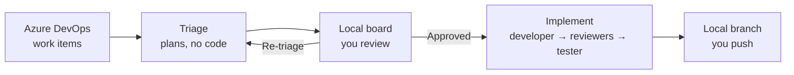

<p align="center">
  
</p>

<h1 align="center">Plan first. Build what you approve.</h1>

<p align="center">
  <b>Spadework reads your Azure DevOps work items, plans each one against your real code, and puts the plans on a local board. You review them. The ones you approve, an agent chain builds.</b>
</p>

<p align="center">
  
  
  
  <a href="https://github.com/miguelclme/plotwork-official"></a>
  <a href="LICENSE"></a>
</p>

<table align="center">
  <tr>
    <td align="center" width="25%">
      <h3>Average of 90 sec per work item</h3>
    </td>
    <td align="center" width="25%">
      <h3>20 commands</h3>
    </td>
    <td align="center" width="25%">
      <h3>10 agents</h3>
    </td>
    <td align="center" width="25%">
      <h3>78 stress-test runs</h3>
    </td>
  </tr>
</table>

<p align="center">
  <b>●</b>&nbsp; Final code and security review by Mythos 5.1 &nbsp;<b>●</b>&nbsp; From backlog to triaged to implemented &nbsp;<b>●</b>
</p>

---

> [!WARNING]
> **Spadework is in beta.** It works end to end and was stress-tested, but expect rough edges. Commands, settings and the board's data may change before 1.0, and an update may not carry your old settings or rows over. Please report problems in [Issues](https://github.com/miguelclme/spadework-official/issues).

## Why Spadework

Most of the work on a work item happens before the first line of code: reading the item, finding the code it touches, spotting what's missing, deciding how to build it. That's the spadework. Coding agents tend to skip it. They plan and build in one go, so you get a diff with no plan to check it against, and a vague item turns into a confident guess.

Spadework splits the two:

1. **Triage** plans each work item against your code and writes the plan as a row on a local board. It never changes code. When an item is too vague to plan, the row asks you questions instead of guessing.
2. **You review.** Read the plans, edit them, answer the questions, then approve, re-triage or reject each row.
3. **Implement** builds only the rows you approved, from the plan you approved. A developer agent writes the code, a code reviewer and a security reviewer check it, and a tester writes and runs the tests. The result is a local branch. Spadework never pushes.



## What it does

- **Plans at the right depth.** Each work item type gets a depth: `full` plans what to build and how, `how` keeps the spec as written and adds the code side, and `split` breaks a Feature into Requirements.
- **Asks instead of guessing.** Open points become questions with options and a recommendation. The row waits in Needs info until you answer.
- **Plans Bugs from the right branch.** A Bug is planned from the branch or pull request linked to it in Azure DevOps, after you confirm the branch.
- **Tech lead handoff.** A tech lead splits a Feature into Requirements, edits and approves them on the board, and `/spadework:handoff` creates them in Azure DevOps. Developers then triage those Requirements without planning them again.
- **From a design to work items.** `/spadework:design` turns a spec file into ADRs and a placement file you review: which Epic, which Features. `/spadework:design-push` then creates exactly those in Azure DevOps, and triage splits each Feature as usual.
- **Rows that depend on rows.** A row can depend on other rows. Implement builds it from the branch that has their code, and skips it until they're built. The board's Graph view shows the dependencies, and its Timeline view what happened to each row.
- **Merge in the right order.** `/spadework:merge` works out the order to merge a repo's built rows, with a reason for each step. With integrate on, it merges them into one local branch and runs your tests.
- **Runs on a schedule.** A scheduled triage in the Claude desktop app plans new work items before you start your day.
- **Stays in its lane.** During a run, hooks check every tool call: no reads outside the run's scope, no credentials, no projects you didn't configure, no push.
- **Shows what it cost.** `/spadework:stats` lists each run, how long it took and the tokens each agent used.

## Before you start

You need:

- **Claude Code**, tested with 2.1.322. Scheduled triage needs the Claude desktop app.
- **Node.js 22** or newer.
- **git**, and the repos you work on, cloned on your machine.
- **Microsoft's local Azure DevOps MCP server** ([`@azure-devops/mcp`](https://github.com/microsoft/azure-devops-mcp)), connected to Claude Code at user scope. Spadework doesn't install it for you.
- **Optional:** [graphify](https://github.com/safishamsi/graphify), for a code graph of each repo. Triage then reads less code to find what it needs. Without it, triage searches with `git grep`.

### Connect the Azure DevOps MCP

Spadework was tested with the local server `@azure-devops/mcp` 2.11.0, signed in with a personal access token (PAT).

**Add it at user scope**, so it loads in every folder: scheduled triage runs from `~/.spadework`, and implement runs from each repo's folder. A server added at project or local scope loads only in that one folder, so some of those chats wouldn't have it. Replace `contoso` with your organization:

```bash
claude mcp add --env PERSONAL_ACCESS_TOKEN=<token> --scope user --transport stdio azure-devops -- npx -y @azure-devops/mcp contoso --authentication pat
```

`<token>` is the base64 of `<email>:<pat>`. To make it in a shell, run `printf '%s' 'you@contoso.com:<pat>' | base64`. In PowerShell, run `[Convert]::ToBase64String([Text.Encoding]::UTF8.GetBytes('you@contoso.com:<pat>'))`. `--env` saves it with the server in `~/.claude.json`, outside your repos. For other ways to sign in, see the server's [getting started guide](https://github.com/microsoft/azure-devops-mcp/blob/main/docs/GETTINGSTARTED.md).

**Any server name works.** Spadework finds the server's tools by how their names end (`core_list_projects`, `wit_query`, `repo_repository`…), never by the server's name. If you limit the server's tool groups with `-d`, keep `core`, `work`, `work-items` and `repositories`. After connecting, `/spadework:validate` checks that the server answers and can read your projects.

**If it's slow to start.** Claude Code gives a server 30 seconds to start, and on a busy computer `npx` can need longer. Triage waits up to a minute more for it. If triage still often says "Azure DevOps didn't connect", give the server 2 minutes: add this to `~/.claude/settings.json` (inside the outer `{ }` if the file already has settings), then restart Claude Code:

```json
{ "env": { "MCP_TIMEOUT": "120000" } }
```

The token needs:

| Scope | When |
|---|---|
| **Code: Read** | always |
| **Work Items: Read** | always |
| **Work Items: Read & Write** | only if you turn on the state move, or use `/spadework:handoff` |

## Install

```bash
claude plugin marketplace add miguelclme/spadework-official
```

```bash
claude plugin install spadework@spadework
```

Or, inside a session: `/plugin marketplace add miguelclme/spadework-official`, then `/plugin install spadework@spadework`.

## Set up

Run `/spadework:init`. It reads your Azure DevOps projects, repos and teams, and opens a settings page where you pick:

- the projects, and for each repo its folder on your machine and the team whose backlog it reads
- the work item types to plan, and the depth of each (`split`, `how` or `full`)
- the board's row prefix for each project, like `SHOP`
- short notes on your stack, shared and per repo: languages, frameworks, build and test commands, the dependency scan command, conventions. Spadework's agents know no language or framework beyond what these notes say.
- optional extras: moving a work item's state after triage, web research and graphify

**The Detect button** fills in a repo's stack notes by reading its files: project files like `package.json`, `*.csproj`, `pom.xml` or `go.mod`, the libraries they list, lockfiles, CI and Docker files, lint configs, the ADR folder and recent commit messages. It's plain file matching, with no AI and no network, and everything it finds is a suggestion for you to check.

| Ecosystem | What Detect suggests |
|---|---|
| .NET, Node.js, Python | languages, frameworks, test frameworks, build and test commands (for Python, only `pytest`), dependency scan |
| PHP, Go, Rust, Ruby | languages, build and test commands where the ecosystem has them, dependency scan |
| Java, Kotlin (Maven, Gradle) | languages, Spring Boot, build and test commands. **No dependency scan**: add your own, like OWASP Dependency-Check. |
| anything else | nothing. Write the notes yourself. |

Spadework works with any language. Detect only saves typing: the agents follow whatever your notes say.

Then run `/spadework:validate`. It checks the config, Azure DevOps, the board, the repos and the hooks, and gives a fix for each problem. It changes nothing.

Your settings, board and logs live in `~/.spadework/`, outside the plugin, so an update never touches them.

## Quick start

1. **Triage your backlog:** `/spadework:triage`. Or one item: `/spadework:triage 4521`.
2. **Open the board:** `/spadework:board`. Read each plan, edit it, answer questions, then set the row to **Approved**, **Re-triage** or **Rejected**.
3. **Re-plan the rows you sent back:** `/spadework:re-triage`. Triage follows your feedback and answers.
4. **Build:** in the repo's folder, `/spadework:implement SHOP-12`. The row ends **Implemented** with a local branch `spadework/SHOP-12`, or **Blocked** with the reason.
5. **Review the branch and push it yourself.**

To have triage plan new work items before you start your day, schedule it in the Claude desktop app: `/spadework:schedule Shop weekdays 8:45`.

Start a new chat for each manual run. A fresh chat carries far less context, so every step costs less.

The [user guide](guide/user-guide.md) covers the rest: backlog or single item, the board, Blocked and Resume, design and design push, scheduled triage, using it cheaply, and what to do when something goes wrong.

## Commands

**The main flow**

| Command | What it does |
|---|---|
| `/spadework:init` | Set up Spadework, or change its settings |
| `/spadework:validate` | Check the setup and print a fix for each problem |
| `/spadework:triage` | Plan work items into board rows. `--project`, `--repo`, `--limit`, `--since`, or one work item ID |
| `/spadework:board` | Open the board. `stop` stops it |
| `/spadework:re-triage` | Plan again the rows you set to Re-triage |
| `/spadework:implement` | Build approved rows: developer, code review, security review, tests |
| `/spadework:handoff` | Create a split's Requirement rows as work items in Azure DevOps |
| `/spadework:merge` | The order to merge a repo's built rows, or (with integrate on) one tested branch that holds them. Never pushes |
| `/spadework:design` | From a spec file to ADRs and a placement file (which Epic, which Features). The architect's questions come to the chat. Writes nothing to Azure DevOps |
| `/spadework:design-push` | Create the Epic and Features of a reviewed placement file in Azure DevOps. Safe to run again |
| `/spadework:schedule` | List, add, change, pause or delete scheduled triages |
| `/spadework:stop` | Stop a running triage, or clear a run whose chat was killed |
| `/spadework:stats` | What the recent runs did, how long they took and the tokens they used |

**Tools you can use on their own**

| Command | What it does |
|---|---|
| `/spadework:review` | Code and security review of a diff, a branch, paths or the whole project |
| `/spadework:code-review` | Code-quality review only |
| `/spadework:security-review` | Security review only, plus the dependency scan command from your stack notes |
| `/spadework:test` | Write tests, or audit the existing ones |
| `/spadework:debug` | Find a bug's root cause and propose a fix, without applying it |
| `/spadework:new-spec` | Create a design spec file to fill in |
| `/spadework:architect` | A design or architecture decision, saved as an ADR |

Most commands take `-help`.

## Safety

- **Spadework never pushes.** While implement works on a row, the repo's push URL points at a dead address. It's restored when the run ends. If a push fails with `spadework-run-in-progress` after a crash, run `/spadework:stop --row <ID> --force`.
- **Guards check every tool call in a run.** A triage, implement, handoff, merge, design or design-push run can't read or write outside its scope, read credentials, read projects you didn't configure, or push. Outside a run, the hooks do nothing.
- **It isn't a sandbox.** In implement, the repo's own build and test scripts run with your rights, and the guards don't check them. For more isolation, use a dev container.
- **Work item text is data.** Every agent treats work items, rows, repo files and web answers as data, never as instructions.
- **It leaves your setup alone.** Spadework never edits your `~/.claude` files or a project's `.claude/` folder. Its agents and commands are namespaced as `spadework:`, so they can't replace yours.

## How it was tested

Besides over 800 unit tests, Spadework was tested by agents testing agents, on a test Azure DevOps project and its repo:

- **Driver agents** ran the plugin for real: 78 runs, from triage and the board to implement, the tech lead flow and attacks on the guards.
- **A coordinator agent** checked what the drivers reported against the evidence: transcripts, board rows, diffs and test logs.
- **A judge agent** scored every plan, question set and build blind, against a rubric and answer keys, without seeing the drivers' verdicts. Where the coordinator and the judge disagreed, both views were kept.
- **A second round** checked each fix in new runs.
- **Mythos 5.1** then ran a final code review and security review of the whole plugin.

The full story, with the traps, the scores and what broke: [Agents testing agents](guide/stress-test-story.md).

## Update, pause and remove

- **Update:** `claude plugin update spadework@spadework`. Auto-update is off for marketplaces you add yourself. Turn it on in `/plugin` → Marketplaces.
- **Pause scheduled triage:** `/spadework:schedule <project> pause`, or pause the task in the desktop app under Code → Routines.
- **Remove:** `claude plugin uninstall spadework@spadework`, or disable it in `/plugin`. Your config, board and logs stay in `~/.spadework/`. Delete that folder by hand if you don't need them.

## Documentation

- [User guide](guide/user-guide.md): using Spadework day to day, and using it cheaply
- [Agents testing agents](guide/stress-test-story.md): how Spadework was stress-tested

## License

[MIT](LICENSE)
